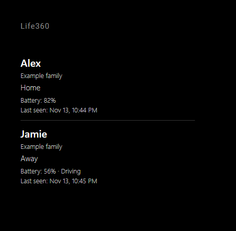

# MMM-Life360-BODK

## Description

A MagicMirror² module displaying Life360 circle members and their latest shared places. The member list is the default; the optional map is disabled with `showMap: false` and loads no map scripts or tiles in that mode. Supports English and Danish, multiple independent instances, circle/member filters and compact styling.

A **circle** is a Life360 group, not a geographic area. The module shows its members and the place name reported by Life360 (for example Home or Work), otherwise the reported address or an away/unknown status. It does not independently calculate geofences, detect arrivals, or request fresh phone locations. Place names and addresses remain unchanged in either UI language.

Inspired by [maxbethge/MMM-Life360](https://github.com/maxbethge/MMM-Life360). This is an **experimental integration using an unofficial API**. Live authentication and device behavior have not been validated. Life360 can change or block access; a valid token does not guarantee API access. See [NOTICE](NOTICE) for upstream attribution.

### Preview

Default list layout with fictional members, places and battery readings. The optional map is disabled. English is the default language.



The [browser preview](docs/preview.html) uses fictional data only; it does not validate external services or hardware.

## Requirements

- A working MagicMirror² installation and a Node.js version supported by that installation, at least Node.js 22.
- A Life360 account with access to the desired circles and members sharing their locations.
- A valid Life360 access token and outbound HTTPS access to the API.
- The default `cycletls` transport runs a bundled native executable. Its published platform binaries include Linux x64/ARM/ARM64 and Windows x64; verify compatibility on the target Raspberry Pi/OS. No OS packages are installed by this module.
- Optional map: internet access to OpenStreetMap tiles. Leaflet scripts and CSS are installed locally by npm.

## Installation

Run these commands on the device running MagicMirror²:

```sh
cd ~/MagicMirror/modules
git clone https://github.com/BravoOscarDK/MMM-Life360-BODK.git
cd MMM-Life360-BODK
npm install
```

Keep the folder name `MMM-Life360-BODK` unchanged. Configure the module below and restart MagicMirror².

## Configuration

Insert this object into the `modules` array in `~/MagicMirror/config/config.js`:

```js
{
  module: "MMM-Life360-BODK",
  position: "top_right",
  header: "Life360",
  config: {
    language: "en",
    accessToken: "YOUR_LIFE360_ACCESS_TOKEN",
    baseUrl: "https://api.life360.com",
    useImpersonation: true,
    circleIds: [],
    showMap: false,
    showCircle: true,
    showLocation: true,
    showBattery: true,
    showLastSeen: true
  }
},
```

### Getting an access token

Set `accessToken` directly in the module's `config` object as shown above. Replace `YOUR_LIFE360_ACCESS_TOKEN` with the token value only, without a `Bearer ` prefix. No environment variable is needed for this setup. Each module instance can have its own token.

Use the browser method described in the [reference project's token instructions](https://github.com/maxbethge/MMM-Life360#getting-an-access-token). It also supports accounts that sign in with an emailed code:

1. Open [Life360 login](https://life360.com/login) in your browser.
2. Open Developer Tools (`F12`, or right-click and select **Inspect**) and select the **Network** tab. Ensure recording is enabled before signing in.
3. Sign in to your own account using its normal password or emailed-code flow. Keep Developer Tools open.
4. Filter the network requests by `token`. Find the `POST` request whose URL ends in `/oauth2/token` (the full path may include `/v3`).
5. Open its **Response** or **Preview** tab and copy the value of `access_token`, without the surrounding quotes. If that response is not available, inspect an authenticated Life360 API request and copy only the value after `Bearer ` in its `Authorization` request header.
6. Test the token on the device running MagicMirror²:

   ```sh
   cd ~/MagicMirror/modules/MMM-Life360-BODK
   node diagnose.js --token
   ```

7. Paste the token at the prompt. Input is visible locally. A `SUCCESS` result means that host/transport can retrieve your circles. If CycleTLS succeeds and fetch gets HTTP 403, use `useImpersonation: true`; the fetch failure does not invalidate the successful CycleTLS test. Use the successful `baseUrl` printed by the diagnostic.
8. Paste the same token into `accessToken` in `~/MagicMirror/config/config.js`, apply the working host/transport settings, save the file and fully restart the MagicMirror² server process. Reloading the browser alone does not reload the server configuration.

**The diagnostic does not save the token or configure the module.** A successful diagnostic followed by a missing-token configuration warning means you still need to put the token in the module configuration.

This module does not implement password login, email-code login, automatic token refresh or a token cache, and does not include the reference project's `get-token.js`. If the token is rejected or revoked, repeat the browser steps, replace `accessToken` and restart MagicMirror². The website and authentication flow can change; these steps do not guarantee access.

Keep your configuration private: a token grants account access and direct `accessToken` values in MagicMirror² configuration can be exposed to its browser. Never commit a real token or share screenshots, configuration files or logs containing it.

### Circle and member IDs

To restrict circles, inspect the authenticated `/v3/circles` response in the same browser session and copy the desired `id` values into `circleIds`. Member IDs are available in `/v3/circles/<circle-id>/members`. Empty arrays select all accessible circles/members. Members appearing in several selected circles are shown once, with all circle names and their newest available shared location. An explicitly selected but unavailable circle produces a configuration warning.

### Options

| Option | Default | Description |
| --- | --- | --- |
| `language` | `"en"` | English or Danish; regional codes supported; unsupported/empty codes use English |
| `accessToken` | `""` | Paste your captured token here; used by the setup above and takes precedence over environment lookup |
| `accessTokenEnv` | `"LIFE360_ACCESS_TOKEN"` | Optional alternative for environment-based setups; unnecessary when `accessToken` is set; `""` disables environment lookup |
| `baseUrl` | `"https://api.life360.com"` | Other supported host: `https://api-cloudfront.life360.com` |
| `useImpersonation` | `true` | Use CycleTLS browser TLS transport; `false` uses native Node fetch |
| `circleIds` | `[]` | Include selected circle IDs; empty means all |
| `memberIds` | `[]` | Include selected member IDs; empty means all |
| `updateInterval` | `60000` | Delay after a completed poll in milliseconds; integer, minimum `30000` |
| `requestTimeout` | `20000` | Timeout per request in milliseconds, integer `1000`–`60000` |
| `width` | `"340px"` | CSS module width |
| `layout` | `"default"` | `default` or `compact` |
| `animationSpeed` | `300` | DOM animation duration in milliseconds; `0` disables animation |
| `maxMembers` | `0` | Maximum members in the list and map; `0` means all; sorted by name |
| `showMap` | `false` | Enable an OpenStreetMap view with member markers |
| `mapHeight` | `"260px"` | CSS map height |
| `mapZoom` | `13` | Zoom for one member and maximum auto zoom; integer `0`–`19` |
| `showCircle` | `true` | Display circle names |
| `showLocation` | `true` | Display reported place/address/status |
| `showAddress` | `true` | Use the address when no named place is reported; `false` shows an away/unknown label |
| `showBattery` | `true` | Battery percentage and charging status, when reported |
| `showDriving` | `true` | Driving indicator, when reported |
| `showLastSeen` | `true` | Localized date/time of the phone's location report |
| `showLastUpdate` | `false` | Last successful server poll time |
| `staleAfter` | `900000` | Age in milliseconds before warning about stale location/poll data; `0` warns immediately |

See [config.example.js](config.example.js). Standard MagicMirror² `header`, `position` and `classes` options work. Custom header text remains unchanged.

### Display and privacy

Use only information shared with your account. Location sharing off suppresses location, battery and driving data for that circle. Missing locations are shown as unavailable; timestamps are not replaced by the poll time. An error preserves the previous successful data with a visible warning. Stale data receives a warning even when last-seen text is hidden.

`showAddress: false` hides address text, but the optional map still uses coordinates. `showLocation: false` hides the location text independently of `showMap`. With `showMap: true`, the browser contacts OpenStreetMap's tile service for the visible area. Attribution stays visible; map interaction is disabled. Turn it off to avoid map requests entirely. Tile usage is subject to [OpenStreetMap's tile policy](https://operations.osmfoundation.org/policies/tiles/).

Override styles in `~/MagicMirror/css/custom.css`:

```css
.MMM-Life360-BODK .life360-bodk {
  --life360-gap: 8px;
  --life360-warning: #ffb454;
}
```

## Language

English is always the default regardless of MagicMirror²'s global language. Set `language: "da"` for Danish; `da-DK` is also accepted. Unsupported languages and missing translation keys fall back to English. Dates use the module's locale and device timezone without changing global date settings. Member names, circle names, custom labels and upstream place/address data are preserved.

## Updating

Update the installed checkout:

```sh
cd ~/MagicMirror/modules/MMM-Life360-BODK
git pull --ff-only
npm install
```

Restart MagicMirror² using your normal startup method. Your external configuration and environment settings are preserved.

## Troubleshooting

### Token diagnostics

Run `node diagnose.js --token` from the module folder and paste your captured token at the prompt (input is visible in your local terminal). Alternatively, set `LIFE360_ACCESS_TOKEN` in that shell and run `node diagnose.js`; `LIFE360_TOKEN` is also accepted. The command does not read MagicMirror² configuration or another process's environment. Run `node diagnose.js --help` for usage.

The diagnostic tests `/v3/circles` once per supported host and transport (CycleTLS and native fetch), using the module's actual transport and timeouts. It prints success counts or error categories and suggests `baseUrl` and `useImpersonation` when a combination works. It stops immediately on rate limiting. Exit code 0 means at least one combination succeeded; 1 means failure, rate limiting or invalid input. It does not print tokens, response bodies, circle names or locations, or write data to disk. Unlike the upstream diagnostic, it tests captured tokens only; password login is not supported. A successful circles request does not validate member locations or the display on your target device.

- **Missing-token configuration warning:** set `accessToken` inside this module's `config` object in `~/MagicMirror/config/config.js` and fully restart MagicMirror². A token pasted into `diagnose.js` is not saved for the module. For other configuration warnings, check ID arrays, supported HTTPS host, and interval/timeout ranges. Configuration is validated before API requests start.
- **401/token rejected:** capture a new token, replace `accessToken` in local configuration, and restart. Automatic polling stops for this error.
- **403/access blocked:** access may be rejected by Life360 or its protection service. Check the default CycleTLS transport and target platform. You can try the other supported API host; success is not guaranteed. Polling stops to avoid repeated blocked requests. Restart after correcting settings.
- **429/network/server failure:** polling backs off exponentially, capped at 30 minutes, and stops after five consecutive failures. A message tells you when updates stop; check access and restart. There is no immediate retry loop. Polls never overlap within an instance.
- **No people or place names:** check circle/member filters, account access and sharing in Life360. Empty selected circles are valid. A named place appears only when upstream reports it; there is no local geofence engine or reverse geocoding.
- **CycleTLS cannot start:** run `npm install` on the target device, check binary/architecture compatibility and execution permissions. `useImpersonation: false` selects fetch explicitly, which may be blocked too. Native requests have a timeout and abort on suspension. CycleTLS requests in flight can finish up to their timeout when another instance still uses the process; their results are discarded. The native process closes when the final instance stops.
- **Map blank:** verify `showMap: true`, coordinates, tile connectivity and the installed Leaflet assets. No map service key is needed. This optional map still needs target-device visual validation.

Diagnostics contain error categories only, never response bodies, names, coordinates or tokens. No member data or tokens are cached on disk by the module. Tokens placed in the environment remain subject to your operating system and process manager's access controls.

## Validation

```sh
npm install
npm run check
npm test
npm run smoke
git diff --check
```

Checks cover JavaScript/config syntax, English defaults, Danish/regional selection and fallback, member normalization, sharing disabled, circle filtering, deduplication, error handling, instance isolation, polling cleanup, and list/map switch behavior. External requests and MagicMirror² lifecycle calls are mocked. `npm run smoke` additionally launches the installed CycleTLS executable, requests a local HTTP mock with a fictional token, and closes the process. Windows automated checks and that local smoke test have passed. These checks do not prove live Life360 access, token validity, map rendering in Electron, or Raspberry Pi support. Validate those on your target system with your account before relying on the display.

## License

MIT; see [LICENSE](LICENSE) and [NOTICE](NOTICE). This module is not affiliated with Life360.
